<picture>
  <source media="(prefers-color-scheme: dark)" srcset="./assets/hero-dark.svg">
  <source media="(prefers-color-scheme: light)" srcset="./assets/hero-light.svg">
  
</picture>

<p align="center">
  <a href="https://kedhar.vercel.app"><code>kedhar.vercel.app</code></a> ·
  <a href="https://21st.dev/@kedhareswer"><code>21st.dev</code></a> ·
  <a href="https://linkedin.com/in/kedhareswernaidu"><code>linkedin</code></a> ·
  <a href="https://www.kaggle.com/kedhareswernaidu"><code>kaggle</code></a> ·
  <a href="./Assests/Kedhareswer_AI_Engineer.pdf"><code>résumé.pdf</code></a>
  <br><br>
  
</p>

## Model card · `kedhar-v2026`

| field | value |
| --- | --- |
| **Architecture** | AI engineer × full-stack developer |
| **Serving** | Software Developer at DiligenceVault: agent orchestration for financial documents |
| **Training data** | B.Tech CSE, Data Science (AI & ML), Lovely Professional University, 2021–2025 · AI Engineer intern, DiligenceVault · Research intern, upGrad Campus (hybrid YARA + ML malware detection) · AI evaluator, Outlier.AI |
| **Intended use** | LLM apps, RAG pipelines, agentic systems, computer vision, shipped full-stack |
| **Region** | Madanapalli, Andhra Pradesh, India |
| **Open to** | AI research collaborations: medical AI, bioinformatics, LLM systems, MLOps |

## Evaluation

<picture>
  <source media="(prefers-color-scheme: dark)" srcset="./assets/eval-dark.svg">
  <source media="(prefers-color-scheme: light)" srcset="./assets/eval-light.svg">
  
</picture>

## Checkpoints

| step | checkpoint | notes |
| --- | --- | --- |
| 01 | [21st.dev catalog](https://21st.dev/@kedhareswer) | 118 free React components. #1 of 1,186 authors, Oct 2026. |
| 02 | [Kedhar Brain](https://kedhar-brain.vercel.app) | My notes as an agentic platform: OKF bundle, MCP tools, Claude Managed Agents. |
| 03 | [ThesisFlow-AI](https://thesisflow-ai.vercel.app/) | Research workspace: cited AI chat, literature discovery, team planning. |
| 04 | [QuantumPDF](https://github.com/Kedhareswer/QuantumPDF_ChatApp_VectorDB) | Chat with documents across 19+ LLM providers, hybrid search, citations. |
| 05 | [LLM Agentic Chess](https://llm-chess-agentic.vercel.app/) | LLMs play validated chess matches, rated by ELO. |
| 06 | [kedhar.vercel.app](https://kedhar.vercel.app) | Work reel, case studies and a chatbot that answers as me. |

## Training log

<picture>
  <source media="(prefers-color-scheme: dark)" srcset="./assets/training-dark.svg">
  <source media="(prefers-color-scheme: light)" srcset="./assets/training-light.svg">
  
</picture>

<picture>
  <source media="(prefers-color-scheme: dark)" srcset="https://github-trophies.vercel.app/?username=Kedhareswer&theme=tokyonight&no-frame=true&no-bg=true&row=1&column=7&margin-w=10&margin-h=10">
  <source media="(prefers-color-scheme: light)" srcset="https://github-trophies.vercel.app/?username=Kedhareswer&theme=flat&no-frame=true&no-bg=true&row=1&column=7&margin-w=10&margin-h=10">
  
</picture>

[](https://holopin.io/@kedhareswer)

## Dependencies

```text
# languages
python  typescript  javascript  sql  r
# ai / ml
pytorch  tensorflow  keras  scikit-learn  opencv
llms  rag  agents  nlp  computer-vision
# web
react  next.js  tailwind  shadcn/ui  fastapi  node.js
# data
pinecone  faiss  weaviate  postgres  mysql  pandas  numpy
# infra
aws  azure  vercel
```

## Limitations

Ships a basic idea before it is brilliant. On purpose: *"A basic idea in progress beats a brilliant idea that never begins."*

## Citation

```bibtex
@misc{kedhar2026,
  author = {Kedhareswer Naidu},
  title  = {kedhar: AI engineer and full-stack developer},
  year   = {2026},
  url    = {https://kedhar.vercel.app}
}
```
